<p align="center">
  
</p>

<p align="center">
  
  
  
  
  
  
</p>

<p align="center">
  An end-to-end data pipeline where the code is generic and the <b>config is the brain</b>.<br>
  New data sources are onboarded with a few lines of YAML, not new code.
</p>

## The problem

A crypto analytics team needs reliable, fresh market data, but their current approach is broken:

- Analysts pull data with one-off scripts, so there are **gaps, duplicates and inconsistent formats**.
- Adding a new coin or data source **needs a developer and new code** every time.
- Nobody knows when a load **fails or data goes stale** until a report looks wrong.
- Raw API data (unnamed arrays, numbers stored as strings) **isn't analysis-ready**.

## The solution

| | |
|---|---|
| 🧩 **Config-driven** | Sources are defined in `sources.yaml`. Adding one is a config change, not a code change. |
| 🔁 **Incremental loads** | Watermarks prevent gaps and duplicates across runs. |
| 🥉🥈🥇 **Medallion layers** | Raw data lands in bronze, gets typed and validated in silver, becomes metrics in gold. |
| 📋 **Audited and monitored** | Every run is logged; freshness and failures are visible on a dashboard. |
| ⏱️ **Automated** | Runs every hour on GitHub Actions. |

<p align="center">
  
</p>

## Success criteria

| Goal | Target | Status |
|---|---|---|
| Onboard a new source | under 5 minutes, YAML only | ⏳ |
| Duplicate rows after repeated runs | 0, proven by tests | ⏳ |
| Data freshness | within ~1 hour | ⏳ |
| Run history | every run logged, success rate visible | ⏳ |

<p align="center">
  
</p>

## Build log

Every step has its own guide in [`docs/`](docs) and a git tag, so you can see the code exactly as it was at that point (`git checkout step-01`).

| Step | What gets built | Guide | Status |
|---|---|---|---|
| 00 | Project setup, structure, first config | [00-setup](docs/00-setup.md) | ✅ Done |
| 01 | Config-driven API connector + connector registry | [01-api-connector](docs/01-api-connector.md) | ✅ Done |
| 02 | Parquet writer: land raw data in bronze | | ⏳ Next |
| 03 | Runner: run every enabled source from config | | 🔜 Planned |
| 04 | State and watermarks: incremental loads | | 🔜 Planned |
| 05 | Audit logging for every run | | 🔜 Planned |
| 06 | Schema drift, retries, CSV connector | | 🔜 Planned |
| 07 | Silver and gold layers | | 🔜 Planned |
| 08 | Tests with pytest | | 🔜 Planned |
| 09 | Hourly runs on GitHub Actions | | 🔜 Planned |
| 10 | Live Streamlit dashboard | | 🔜 Planned |

## Add a source in 30 seconds

```yaml
- name: sol_usdt_hourly
  type: api
  url: https://api.binance.com/api/v3/klines
  params:
    symbol: SOLUSDT
    interval: 1h
  columns: *kline_columns
  target: bronze/crypto/sol_usdt_hourly
  enabled: true
```

No Python changes. The connector registry picks the right connector from `type`.

## Run it locally

```bash
git clone https://github.com/IqraBaluch/config-driven-data-pipeline.git
cd config-driven-data-pipeline
python -m venv .venv
.venv\Scripts\activate          # Windows
# source .venv/bin/activate     # Mac / Linux
python -m pip install -r requirements.txt
```

## Project structure

```
config-driven-data-pipeline/
├── configs/sources.yaml       # the metadata: what to ingest and how
├── ingestion/
│   ├── connectors/            # how to read each source type (registry, base, api)
│   ├── writer.py              # writes Parquet to the bronze layer
│   ├── state.py               # watermarks for incremental loads
│   └── runner.py              # reads config, runs every enabled source
├── docs/                      # step-by-step build guide
├── tests/
└── assets/                    # README images
```

## About me

Data engineer working with Microsoft Fabric, Databricks and Snowflake (SnowPro Core certified). Profile: [github.com/IqraBaluch](https://github.com/IqraBaluch)
